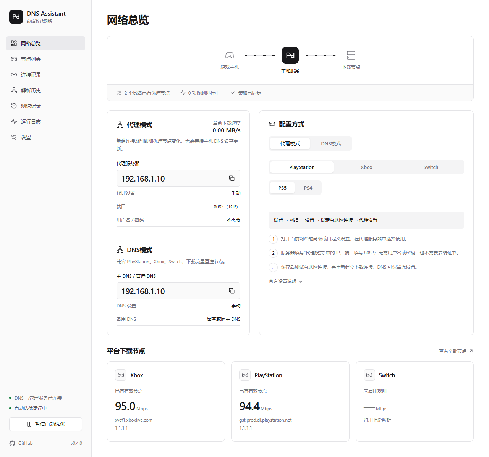

<div align="center">


# DNS Assistant

**游戏主机下载加速，让游戏下载与更新更顺畅**

为 Xbox、PlayStation 和 Nintendo Switch 自动测速、优选下载节点，通过 DNS 或下载代理改善游戏下载速度。

[下载](#下载)　[Docker 使用](#docker-使用)　[产品官网](https://leoskey.github.io/dns-assistant/)　[反馈问题](https://github.com/leoskey/dns-assistant/issues)

</div>



<p align="center"><sub>网络总览（示例数据）</sub></p>

## 游戏下载加速

按实际下载表现选择节点，帮助游戏主机避开当前较慢的下载线路。定期复测并在节点异常时自动回退，持续为游戏下载和更新选择合适的节点。

- **DNS 加速**：游戏主机使用优选节点解析，后续下载连接直达选中的节点。
- **代理加速**：新建下载连接时使用当前优选节点，无需等待主机 DNS 缓存刷新。
- **多平台接入**：内置 PS5／PS4、Xbox 和 Switch 配置指引，支持手动复测与暂停自动选优。

## 管理功能

- **下载与解析记录**：查看代理实时下载速度、活动连接、解析历史、测速结果和运行日志。
- **规则与配置管理**：按游戏平台管理下载域名，支持自定义规则、订阅更新，以及配置备份与恢复。

## 下载

| 形式 | 使用方式 | 获取 |
| --- | --- | --- |
| **Windows 安装版** | 开始菜单启动 | [安装包](https://github.com/leoskey/dns-assistant/releases) |
| **Windows 便携版** | 解压后运行 EXE | [便携包](https://github.com/leoskey/dns-assistant/releases) |
| **Docker 版** | 家庭服务器网页管理 | [直接使用](#docker-使用) |

Windows 版支持 Windows 10／11 x64，安装版与便携版均提供独立管理窗口和托盘菜单。

## Windows 桌面体验

- **关窗继续运行**：关闭管理窗口后驻留托盘，双击托盘图标即可恢复。
- **常用操作随手可用**：从托盘检查更新、切换开机启动、打开数据目录或退出程序。
- **更新保留数据**：托盘更新自动备份数据并重启，也支持离线更新。
- **登录后自动运行**：可随当前用户登录启动；普通启动、登录启动和更新重启均不弹命令行窗口。

## Docker 使用

支持 Linux amd64／arm64。一个容器运行 DNS、下载代理和管理页面，全部数据保存在同一个数据卷中，无需服务密钥或环境文件。

### 1. 保存 compose.yaml

在家庭服务器上新建目录，保存以下配置：

```yaml
name: dns-assistant
services:
  app:
    image: ghcr.io/leoskey/dns-assistant:latest
    ports:
      - "0.0.0.0:53:5353/udp"
      - "0.0.0.0:53:5353/tcp"
      - "0.0.0.0:8080:8080"
      - "0.0.0.0:8082:8082"
    volumes:
      - data:/data
    read_only: true
    cap_drop: [ALL]
    security_opt: ["no-new-privileges:true"]
    logging:
      driver: json-file
      options:
        max-size: "10m"
        max-file: "3"
    restart: unless-stopped
    stop_grace_period: 20s
    mem_limit: 512m
    healthcheck:
      test: ["CMD", "dns-assistant", "health"]
      interval: 30s
      timeout: 5s
      retries: 3
volumes:
  data:
```

### 2. 启动并接入游戏主机

在 `compose.yaml` 所在目录执行：

```sh
docker compose pull
docker compose up -d --wait
```

打开 `http://服务器局域网IP:8080`：

- **DNS 模式**：主 DNS 填服务器的局域网 IP。
- **代理模式**：代理服务器填同一 IP，端口填 `8082`。

服务器需保持运行，TCP／UDP `53`、TCP `8080` 和 `8082` 端口需可用。配置与记录保存在 `data` 数据卷中。

### 更新

在同一目录执行，保留原有配置和记录：

```sh
docker compose pull
docker compose up -d --wait
```
