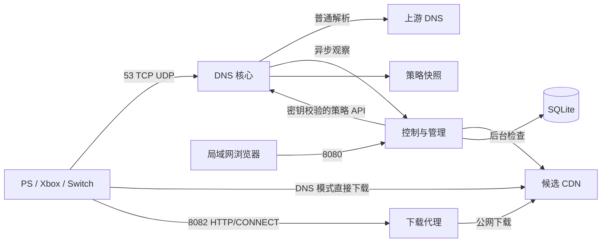

# 实现与技术选型

更新：2026-10-20。有效规格：[需求](../requirements.md)、[验收矩阵](../acceptance.md)。实际测试结果见 [验证记录](../validation.md)。

## 当前技术

| 层 | 已采用 | 说明 |
| --- | --- | --- |
| 后端 | Go 1.27.2 | 标准库 HTTP、日志、上下文与有界任务 |
| DNS | dnsproxy v0.86.0、miekg/dns v1.1.72 | 复用监听、转发、缓存；使用公开 Handler 扩展本地策略 |
| 选优 | 自有后台调度与状态机 | 指定 IP 的 HTTP 内容／吞吐检查，本轮持续速度排名、接近保留、故障回默认后复测 |
| Web | React、TypeScript、Vite、React Router | 局域网免登录单页应用，静态文件嵌入 Go |
| 数据 | SQLite，modernc.org/sqlite v1.60.1 | CGo-free，WAL，控制进程独占数据库，显式事务 |
| 实时状态 | REST JSON + SSE | 观察状态，断线后重新读取完整状态 |
| 部署 | 一个镜像、两个 Compose 服务 | 非 root、只读根目录、独立数据卷、局域网发布端口 |

具体前端版本以 [锁文件](../../web/package-lock.json) 为准；Go 版本依据 [官方发布记录](https://go.dev/doc/devel/release)，React 的静态单页构建依据 [官方指南](https://react.dev/learn/build-a-react-app-from-scratch)。
原始引擎比较见 [调研](../research/dns-engine-comparison.md)。AdGuard Home 未引入；dnsproxy 仅是应用内代码依赖，管理与选优均由本项目提供。

## 进程与数据边界



DNS 子命令在容器内监听 5353，Compose 发布宿主机 53/TCP 和 53/UDP；策略接口 9090 不发布到宿主机。controller 提供 Web 8080 与内部观察入口 8081，只有 Web 发布到指定 SERVER_IP。

SQLite 保存配置、IPv4 策略、版本、持久调度、同步状态、接入与探测明细、事件及每日汇总。配置与策略相关状态事务提交后更新内存。schema 1/2/3 升级到 4，保留 daily 汇总并新增独立连接记录表、删除旧预算表，拒绝未来 schema。测速结果与汇总在同一事务写入；汇总按 UTC 日/域名分组，保留 90 天/10,000 行。
四个记录接口用最大 ID 作为分页快照，在同一读取事务中计算总数并取页；新增记录不影响既有快照，清理后超出范围的页码收敛到末页。记录写入事务同时按递增 ID 限制条数，查询／结果／事件分别最多 10,000／5,000／500 条。独立维护任务在 controller 启动及每小时执行时间与数量清理，保留窗口分别为 7／30／30 天，并尝试截断 WAL；已释放 SQLite 页面供后续写入复用。维护任务随 controller 上下文退出，与测速 worker 是否运行、成功无关。DNS 仍仅通过有界异步观察队列上报，不直接读写 SQLite。

DNS 独占 JSON 快照，先验证与落盘再原子切换。策略按域名与地址族排序、时间统一为 UTC，逻辑相同的同版本重传幂等；禁止版本回退及同版本改变内容。保存的对象复制后发布，调用方不能改变服务中的快照。管理离线时保留未过期策略，过期后普通解析。

## DNS 适配

请求通过配置来源检查及每来源限流后，先检查未过期的精确域名／地址族策略。命中生成本地 A；启用目标 AAAA 返回本地 NODATA；未命中委托 dnsproxy 默认 Handler，保留普通缓存。明确使用 parallel 上游模式，失败上游不会延迟其他可用上游应答；全部上游失败返回 SERVFAIL。优选结果不进入普通缓存，因此切换无需清空全局缓存。

合成应答通过 miekg/dns 创建，明确 RA、AA、AD、压缩和 EDNS／UDP 截断语义。CNAME 普通解析、NXDOMAIN／NODATA、大回答与 TCP 回退通过协议集成测试；A 查询要求 DO／CD 时及 HTTPS／SVCB 走上游，不声称合成地址仍具有原上游签名有效性。使用公开 API，无上游私有代码分支。[dnsproxy Handler](https://github.com/AdguardTeam/dnsproxy/blob/v0.86.0/proxy/requesthandler.go)

监听与上游配置变化采用受控重启 DNS 引擎，业务策略热更新不重启监听器。Compose 仅通过 IPv4 发布入口，选优只使用公网 IPv4；普通域名 AAAA 仍可通过 IPv4 DNS 查询。DNS 核心库的通配监听在容器内可能使用双栈套接字，对外可达性由发布地址和来源白名单共同限制。

dnsproxy 仍传递依赖维护范围收缩的 miekg/dns。保留依赖升级回归和适配边界，持续观察新一代迁移；不以复用代理库代替协议测试。[miekg/dns 维护公告](https://github.com/miekg/dns)

## 自动选优

候选来自各上游 A 应答、手工/订阅候选和当前节点，去重后全部参加串行吞吐；不截断到 8 个，不以延迟选择 3 个。每个候选必须通过本域名样本验证，不承诺获得全站全部 IP。

连接/响应头及下载窗口分别限时；HTTP(S) 保持原域名 Host/SNI 和证书验证，定向公网 IPv4，不继承代理、不跨节点复用。吞吐发送开放 Range，按时长停止，预热 min(500ms, 窗口/5) 后的字节/时间计算速度；不足完整窗口的短样本不参与排名。健康检查最多读取 64 KiB，只验证当前 IP 的可用性。

默认完整复测 24 小时、健康检查 30 分钟、下载窗口 5 秒；健康优先并在候选之间执行。有效期默认 2 小时，至少两个健康周期加 10 分钟余量。正常复测完成前保留旧 IP；当前速度相近（5% 内）维持，明显更快且 5 分钟冷却结束则单轮切换。健康失败撤销策略并发布默认，再完整复测；失败按 15–240 分钟指数退避。调度持久化，重启不重置已完成测试。

配置更改递增任务代次、取消旧工作；提交结果时核对代次与配置，旧样本不得激活。恢复默认隔离旧工作，直到计划/手动复测。规则订阅经独立 HTTPS 公网解析校验、无重定向、20 秒超时/1 MiB 上限后校验整表再事务提交；失败保留上次可用规则。

内置 Nintendo 网络检测样本不能证明实际游戏下载节点有效，实际下载域名需要对应内容样本。当前不进行 HTTPS 解密或跨域地址重写。

## 管理访问

按用户最终要求移除账户、密码和登录。管理入口仅允许配置网段及允许 Host；IP／localhost 默认可用，其他主机名通过 ADMIN_HOSTS 明确允许。写操作要求同源 Origin 与 X-DNS-Request: 1，自定义请求头配合无 CORS 授权阻止跨站写入。反向代理不得把管理入口暴露给不受信任网络。

服务间接口始终使用随机 SERVICE_TOKEN；该值不进入浏览器或配置备份。配置恢复校验完整格式、未知字段及上限。前端不依赖外部 CDN。

## 文件组织

```text
cmd/dns-assistant/main.go  命令、启动、健康检查与退出
internal/app/types.go     配置、规则和策略模型、校验
internal/app/dns.go       DNS 适配、快照、内部策略接口
internal/app/probe.go     受限 HTTP／TLS 探测
internal/app/selection.go 选择与切换状态机
internal/app/manager.go   调度、去重和策略发布
internal/app/store.go     SQLite 事务、记录与汇总
internal/app/http.go      管理 API、来源校验与 SSE
internal/app/app_test.go  协议、HTTP、事务、故障与安全测试
internal/ui/             内嵌 Web 资源
web/src/                 React 界面与状态呈现测试
deploy/                  服务主机安装前检查脚本
```

小型应用将业务代码保留在一个 app 包，避免在需求尚未扩大时拆出重复接口。已锁定依赖与基础镜像摘要；第三方许可文本随镜像保存。镜像、模拟运行、服务主机和真实主机证据分别记录。

## 下载代理候选

当前候选增加 Go HTTP/CONNECT 下载代理和独立连接记录表，复用配置访问网段及优选策略。controller 的 TCP 8082 与 DNS 服务独立；schema 4 不兼容旧程序直接打开，回滚须恢复配套冷备份。
