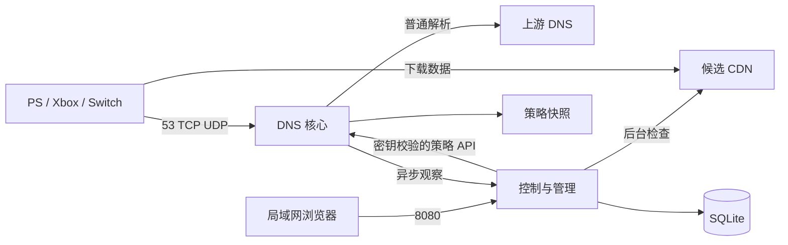

# 实现与技术选型

更新：2026-10-20。有效规格：[需求](../requirements.md)、[验收矩阵](../acceptance.md)。实际测试结果见 [验证记录](../validation.md)。

## 当前技术

| 层 | 已采用 | 说明 |
| --- | --- | --- |
| 后端 | Go 1.27.2 | 标准库 HTTP、日志、上下文与有界任务 |
| DNS | dnsproxy v0.86.0、miekg/dns v1.1.72 | 复用监听、转发、缓存；使用公开 Handler 扩展本地策略 |
| 选优 | 自有后台调度与状态机 | 指定 IP 的 HTTP 内容／吞吐检查，近期中位数和成功率、备用与迟滞 |
| Web | React、TypeScript、Vite、React Router | 局域网免登录单页应用，静态文件嵌入 Go |
| 数据 | SQLite，modernc.org/sqlite v1.60.1 | CGo-free，WAL，控制进程独占数据库，显式事务 |
| 实时状态 | REST JSON + SSE | 观察状态，断线后重新读取完整状态 |
| 部署 | 一个镜像、两个 Compose 服务 | 非 root、只读根目录、独立数据卷、局域网发布端口 |

具体前端版本以 [锁文件](../../web/package-lock.json) 为准；Go 版本依据 [官方发布记录](https://go.dev/doc/devel/release)，React 的静态单页构建依据 [官方指南](https://react.dev/learn/build-a-react-app-from-scratch)。
原始引擎比较见 [调研](../research/dns-engine-comparison.md)。AdGuard Home 未引入；dnsproxy 仅是应用内代码依赖，管理与选优均由本项目提供。

## 进程与数据边界



DNS 子命令在容器内监听 5353，Compose 发布宿主机 53/TCP 和 53/UDP；策略接口 9090 不发布到宿主机。controller 提供 Web 8080 与内部观察入口 8081，只有 Web 发布到指定 NAS_IP。

SQLite 保存 config、selections、version、探测记录、事件和预算。配置、选择与版本在同一事务提交后才更新内存；探测费用先预留，干净结束后退还未消费字节，进程崩溃不会重置预算。显式校验数据库 schema，拒绝打开更高版本作为当前版本。

DNS 独占 JSON 快照，先验证与落盘再原子切换。策略按域名与地址族排序、时间统一为 UTC，逻辑相同的同版本重传幂等；禁止版本回退及同版本改变内容。保存的对象复制后发布，调用方不能改变服务中的快照。管理离线时保留未过期策略，过期后普通解析。

## DNS 适配

请求通过配置来源检查及每来源限流后，先检查未过期的精确域名／地址族策略。命中生成本地 A／AAAA；未命中委托 dnsproxy 默认 Handler，保留普通缓存。明确使用 parallel 上游模式，失败上游不会延迟其他可用上游应答；全部上游失败返回 SERVFAIL。优选结果不进入普通缓存，因此切换无需清空全局缓存。

合成应答通过 miekg/dns 创建，明确 RA、AA、AD、压缩和 EDNS／UDP 截断语义。CNAME 普通解析、NXDOMAIN／NODATA、大回答与 TCP 回退通过协议集成测试；要求 DO／CD 的请求和 HTTPS／SVCB 走上游，不声称合成地址仍具有原上游签名有效性。使用公开 API，无上游私有代码分支。[dnsproxy Handler](https://github.com/AdguardTeam/dnsproxy/blob/v0.86.0/proxy/requesthandler.go)

监听与上游配置变化采用受控重启 DNS 引擎，业务策略热更新不重启监听器。IPv4／IPv6 记录分别选择；容器 IPv6 监听和家庭 IPv6 路由仍需部署侧验证。

dnsproxy 仍传递依赖维护范围收缩的 miekg/dns。保留依赖升级回归和适配边界，持续观察新一代迁移；不以复用代理库代替协议测试。[miekg/dns 维护公告](https://github.com/miekg/dns)

## 自动选优

候选来自多个上游对目标域名的解析、配置中的额外候选和原有效节点。每域名每轮最多检查 8 个发现候选；候选较多时以连接初筛挑选少量吞吐样本，保留原节点参与比较。单出口吞吐串行；此上限不意味着覆盖全部互联网节点。

探测 URL 必须属于规则域名及支持的平台下载后缀；拒绝内网、环回、链路本地、文档与转换等特殊地址。生产代码只能连接公网候选。自定义 DialContext 固定候选连接，保留 Host／SNI 和证书校验；禁用环境代理继承、压缩与跨候选长连接。仅允许同源同路径的受限重定向。

验证 HTTP 状态、Range、内容类型、最低字节数及可选内容前缀；即使服务器忽略 Range 仍受读取上限。采样时间窗口结束时，已有足够有效内容可作为部分采样；明确取消、无效响应或不足内容保持失败。计时至少 1 ms，避免短采样产生无限速度值。

| 参数 | 默认值 |
| --- | --- |
| 启动 | 立即普通解析，同时后台调度全部启用规则 |
| 健康检查 | 有原节点的规则每 120 秒 |
| 吞吐复测 | 每 1800 秒进入队列，受预算和任务串行限制 |
| 吞吐采样 | 最长 3 秒、最多 8 MiB |
| 每日预算 | 512 MiB，Asia/Shanghai 日界，健康检查可使用预留 10% |
| 切换 | 新节点连续两轮至少优于当前 15%，常规冷却 600 秒 |
| 节点失效 | 两次健康检查失败，验证过的备用生效；无合格备用则普通解析 |
| 策略 | 健康有效期 600 秒，应答 TTL 最长 60 秒 |

每候选最近三次、两小时内的吞吐记录参与成功率与中位数判断。失败／预算不足不会刷新未检查节点的有效期；备用激活后安排吞吐复测。配置更改取消旧任务，受影响规则旧策略失效，恢复自动选优后重新调度。

内置 Nintendo 网络检测样本不能证明实际游戏下载节点有效，实际下载域名需要对应内容样本。当前不进行 HTTPS 解密或跨域地址重写。

## 管理访问

按用户最终要求移除账户、密码和登录。管理入口仅允许配置网段及允许 Host；IP／localhost 默认可用，其他主机名通过 ADMIN_HOSTS 明确允许。写操作要求同源 Origin 与 X-DNS-Request: 1，自定义请求头配合无 CORS 授权阻止跨站写入。反向代理不得把管理入口暴露给不受信任网络。

服务间接口始终使用随机 SERVICE_TOKEN；该值不进入浏览器或配置备份。配置恢复校验完整格式、未知字段及上限。前端不依赖外部 CDN。

## 文件组织

```text
cmd/dns-assistant/main.go  命令、启动、健康检查与退出
internal/app/types.go     配置、规则和策略模型、校验
internal/app/dns.go       DNS 适配、快照、内部策略接口
internal/app/probe.go     受限 HTTP／TLS 探测
internal/app/selection.go 选择与切换状态机
internal/app/manager.go   调度、预算和策略发布
internal/app/store.go     SQLite 事务、记录与预算账本
internal/app/http.go      管理 API、来源校验与 SSE
internal/app/app_test.go  协议、HTTP、事务、故障与安全测试
internal/ui/             内嵌 Web 资源
web/src/                 React 界面与状态呈现测试
deploy/                  NAS 安装前检查脚本
```

小型应用将业务代码保留在一个 app 包，避免在需求尚未扩大时拆出重复接口。已锁定依赖与基础镜像摘要；第三方许可文本随镜像保存。镜像、模拟运行、NAS 和真实主机证据分别记录。
